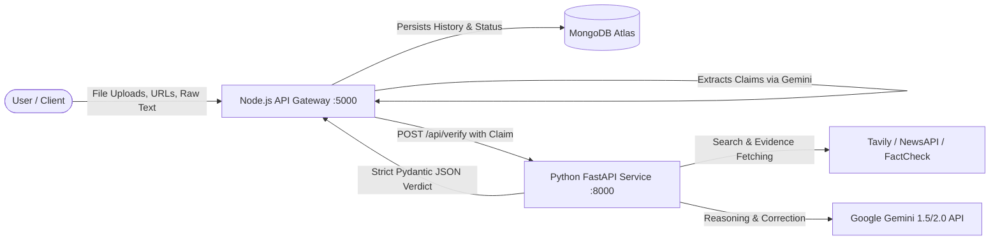

# Trutify: Architecture, Design & Mentorship Guide

Welcome to the comprehensive reference guide for **Trutify** (AI-Powered Multimodal News Verification & Misinformation Correction System). This document explains the engineering decisions, data flows, communication protocols, and module designs.

---

## 1. System Architecture & Rationale

Trutify solves a hard real-world challenge: **misinformation does not come in a single clean format, and fact-checking cannot rely on a simple black-box classifier.**

### 1.1 Why a Two-Backend Architecture?



1. **Node.js (API Gateway & Ingestion Layer):**
   - **Stream and I/O efficiency**: Handles client uploads (images, PDFs) asynchronously with memory-efficient streams.
   - **Network boundary protection**: Validates requests, limits rate, validates MIME types, and guards against Server-Side Request Forgery (SSRF) when fetching external URLs.
   - **Data orchestration**: Manages client sessions, MongoDB connection pools, and tracks processing stages.

2. **Python + FastAPI (Evidence & Reasoning Microservice):**
   - **Data science & AI ecosystem**: Native support for complex asynchronous web scraping, text similarity matching, search engine aggregation, and token manipulation.
   - **Strict Data Contracts with Pydantic**: Guarantees that every piece of evidence, domain authority rating, confidence score, and structured correction strictly conforms to schema before it ever leaves the service.

---

## 2. The Verification Pipeline (Lifecycle of a Request)

Every verification job passes through clearly defined lifecycle states:

```
RECEIVED 
   ↓
EXTRACTING_TEXT (OCR / PDF Parser / Web Scraper)
   ↓
EXTRACTING_CLAIMS (Gemini Claim Isolation)
   ↓
SEARCHING_EVIDENCE (Tavily, NewsAPI, Google Fact Check)
   ↓
ANALYZING_EVIDENCE (Authority Scoring & Evidence Categorization)
   ↓
GENERATING_VERDICT (Gemini Reasoning with Grounded Sources)
   ↓
GENERATING_CORRECTION (Factual Correction Rewrite & Explanation)
   ↓
COMPLETED (Persisted to Database & Returned to Client)
```

If an unrecoverable error occurs at any point, the stage is set to `FAILED` with an intelligible error payload.

---

## 3. Communication Protocols

### 3.1 Client ↔ Node.js Backend
- **Format**: JSON (`application/json`) for text/URL requests; Multipart Form Data (`multipart/form-data`) for file uploads.
- **Base URL**: `http://localhost:5000/api`
- **Security**: CORS headers restricting access to approved frontend domains, Zod request body validation, and helmet HTTP security headers.

### 3.2 Node.js ↔ Python FastAPI Microservice
- **Format**: Strict JSON over HTTP REST.
- **Endpoint**: `POST http://localhost:8000/api/verify`
- **Contract**:
  - Request: `{"claim": "string", "context": "optional string"}`
  - Response: A Pydantic-validated `VerificationResult` containing the verdict, confidence score, categorized evidence lists, sources, and correction fields.

---

## 4. Verdicts & Decision Matrix

Trutify produces one of five mutually exclusive verdicts:

| Verdict | Definition | Required Action |
| :--- | :--- | :--- |
| `VERIFIED` | Multiple reliable, authoritative sources directly corroborate the factual claims. | Produces confirmation summary; no correction generated. |
| `FALSE` | High-authority sources or established fact-checks contradict the claim with demonstrable evidence. | Generates a corrected headline, fact-based rewrite, and explanation of falsehood. |
| `MISLEADING` | Real events or figures are cited, but taken out of context, stripped of timing, or spun deceptively. | Generates contextual correction clarifying the omitted facts. |
| `PARTIALLY TRUE` | The claim contains an element of truth, but includes inaccurate secondary details (e.g., incorrect date, exaggerated numbers). | Generates correction rectifying the inaccurate components while acknowledging the true parts. |
| `UNVERIFIED` | Available search data and reliable sources neither confirm nor refute the claim. | Produces an explanation of uncertainty and limitations; **never** claims it is proven false. |

---

## 5. Security & Safety Pillars

1. **SSRF Guard on URL Ingestion**:
   - Every user-submitted URL is checked against private IP ranges (`127.0.0.1`, `10.0.0.0/8`, `192.168.0.0/16`, `169.254.169.254` AWS metadata, etc.) before any network request is initiated.
2. **Untrusted Evidence Sanitization**:
   - Web search snippets are treated as untrusted text. Prompt templates strictly isolate source snippets from instruction headers to prevent prompt injection attacks.
3. **No Hallucinated URLs or Evidence**:
   - The AI reasoning prompt explicitly forbids creating URLs or citing sources not present in the verified retrieval set.
4. **Temporary File Lifecycles**:
   - Uploaded files for OCR or PDF parsing are validated in memory or written to temporary directories with automatic cleanup after processing.

---

## 6. Implemented Modules & File Directory

### 6.1 Node.js API Gateway (`trutify/backend/node-backend/`)
- [`src/server.js`](file:///c:/Html-CSS-Course/trutify/backend/node-backend/src/server.js): Server entrypoint with `SIGTERM`/`SIGINT` graceful shutdown handling.
- [`src/app.js`](file:///c:/Html-CSS-Course/trutify/backend/node-backend/src/app.js): Express application configuration with Helmet, CORS, Morgan logger, JSON body parser.
- [`src/config/env.js`](file:///c:/Html-CSS-Course/trutify/backend/node-backend/src/config/env.js): Strict environment parser using Zod with fail-fast boot validation.
- [`src/middleware/errorHandler.js`](file:///c:/Html-CSS-Course/trutify/backend/node-backend/src/middleware/errorHandler.js): Centralized error handler managing Zod validations, JSON syntax errors, and HTTP status codes.
- [`src/middleware/notFoundHandler.js`](file:///c:/Html-CSS-Course/trutify/backend/node-backend/src/middleware/notFoundHandler.js): Structured 404 response handler.
- [`src/validators/claimValidator.js`](file:///c:/Html-CSS-Course/trutify/backend/node-backend/src/validators/claimValidator.js): Zod schema validator for claim requests.
- [`src/validators/textValidator.js`](file:///c:/Html-CSS-Course/trutify/backend/node-backend/src/validators/textValidator.js): Zod schema validator for raw text verification requests.
- [`src/services/pythonClient.js`](file:///c:/Html-CSS-Course/trutify/backend/node-backend/src/services/pythonClient.js): Resilient HTTP client for Python FastAPI communication with timeouts and offline circuit protection.
- [`src/services/claimExtractor.js`](file:///c:/Html-CSS-Course/trutify/backend/node-backend/src/services/claimExtractor.js): Gemini-powered factual claim extractor isolating core claims, entities, dates, and opinions.
- [`src/controllers/verifyController.js`](file:///c:/Html-CSS-Course/trutify/backend/node-backend/src/controllers/verifyController.js): Coordinates claim requests between clients and the Python verification engine.
- [`src/controllers/textVerifyController.js`](file:///c:/Html-CSS-Course/trutify/backend/node-backend/src/controllers/textVerifyController.js): Orchestrates text ingestion, claim extraction, and verification pipeline dispatch.
- [`src/controllers/healthController.js`](file:///c:/Html-CSS-Course/trutify/backend/node-backend/src/controllers/healthController.js): Health endpoint handler returning uptime, status, and downstream microservice health.
- [`src/controllers/fileVerifyController.js`](file:///c:/Html-CSS-Course/trutify/backend/node-backend/src/controllers/fileVerifyController.js): Orchestrates image OCR, PDF extraction, claim isolation, and verification.
- [`src/middleware/uploadMiddleware.js`](file:///c:/Html-CSS-Course/trutify/backend/node-backend/src/middleware/uploadMiddleware.js): Multer memory storage with 10MB limit and MIME whitelist (JPEG, PNG, WebP, GIF, PDF).
- [`src/services/ocrService.js`](file:///c:/Html-CSS-Course/trutify/backend/node-backend/src/services/ocrService.js): Hybrid OCR using Tesseract.js with Gemini Multimodal Vision fallback for viral memes and screenshots.
- [`src/services/pdfService.js`](file:///c:/Html-CSS-Course/trutify/backend/node-backend/src/services/pdfService.js): Digital PDF stream text extractor with multi-page support.
- [`src/validators/fileValidator.js`](file:///c:/Html-CSS-Course/trutify/backend/node-backend/src/validators/fileValidator.js): Validation middleware ensuring valid file payload and query options.
- [`src/routes/healthRoutes.js`](file:///c:/Html-CSS-Course/trutify/backend/node-backend/src/routes/healthRoutes.js): Express router mounting `GET /api/health`.
- [`src/controllers/urlVerifyController.js`](file:///c:/Html-CSS-Course/trutify/backend/node-backend/src/controllers/urlVerifyController.js): Coordinates URL article scraping, SSRF checking, claim isolation, and verification.
- [`src/services/urlScraperService.js`](file:///c:/Html-CSS-Course/trutify/backend/node-backend/src/services/urlScraperService.js): Safe Cheerio web article scraper with redirect protection and boilerplate stripping.
- [`src/utils/ssrfGuard.js`](file:///c:/Html-CSS-Course/trutify/backend/node-backend/src/utils/ssrfGuard.js): Multi-layer SSRF defense guarding against private IPv4/IPv6 blocks, AWS metadata, and DNS rebinding.
- [`src/validators/urlValidator.js`](file:///c:/Html-CSS-Course/trutify/backend/node-backend/src/validators/urlValidator.js): Zod schema validator for URL verification requests.
- [`src/routes/verifyRoutes.js`](file:///c:/Html-CSS-Course/trutify/backend/node-backend/src/routes/verifyRoutes.js): Express router mounting `POST /api/verify/claim`, `POST /api/verify/text`, `POST /api/verify/file`, and `POST /api/verify/url`.
- [`src/config/database.js`](file:///c:/Html-CSS-Course/trutify/backend/node-backend/src/config/database.js): Non-blocking Mongoose connection module with graceful shutdown and offline degradation.
- [`src/models/Verification.js`](file:///c:/Html-CSS-Course/trutify/backend/node-backend/src/models/Verification.js): Mongoose model tracking inputs, claims, evidence, verdicts, confidence, corrections, and processing status.
- [`src/services/historyService.js`](file:///c:/Html-CSS-Course/trutify/backend/node-backend/src/services/historyService.js): Service layer for safe verification persistence, paginated history queries, and deletions.
- [`src/controllers/historyController.js`](file:///c:/Html-CSS-Course/trutify/backend/node-backend/src/controllers/historyController.js): History API controller for paginated history and single-item queries.
- [`src/routes/historyRoutes.js`](file:///c:/Html-CSS-Course/trutify/backend/node-backend/src/routes/historyRoutes.js): Express router mounting `GET /api/history`, `GET /api/history/:id`, and `DELETE /api/history/:id`.
- [`tests/health.test.js`](file:///c:/Html-CSS-Course/trutify/backend/node-backend/tests/health.test.js): Automated test suite for healthchecks, routing, and error interceptors.
- [`tests/node_python_integration.test.js`](file:///c:/Html-CSS-Course/trutify/backend/node-backend/tests/node_python_integration.test.js): End-to-end integration test suite testing cross-microservice communication.
- [`tests/text_claim_extraction.test.js`](file:///c:/Html-CSS-Course/trutify/backend/node-backend/tests/text_claim_extraction.test.js): Test suite testing text input validation, Gemini extraction schema, and non-verifiable opinions.
- [`tests/history.test.js`](file:///c:/Html-CSS-Course/trutify/backend/node-backend/tests/history.test.js): Test suite for MongoDB schema validation, history pagination, and safe degradation.
- [`tests/file_verification.test.js`](file:///c:/Html-CSS-Course/trutify/backend/node-backend/tests/file_verification.test.js): Test suite for image OCR, PDF extraction, file validation, and multimodal verification.
- [`tests/url_verification.test.js`](file:///c:/Html-CSS-Course/trutify/backend/node-backend/tests/url_verification.test.js): Test suite for SSRF guard, Cheerio article scraping, and URL verification pipeline.

### 6.2 Python FastAPI Verification Microservice (`trutify/backend/verification-service/`)
- [`app/main.py`](file:///c:/Html-CSS-Course/trutify/backend/verification-service/app/main.py): FastAPI application initialization, CORS middleware, interactive `/docs` and `/redoc`.
- [`app/core/config.py`](file:///c:/Html-CSS-Course/trutify/backend/verification-service/app/core/config.py): Environment settings loaded via Pydantic `BaseSettings`.
- [`app/schemas/verification.py`](file:///c:/Html-CSS-Course/trutify/backend/verification-service/app/schemas/verification.py): Data contracts for `ClaimRequest`, `VerificationResponse`, `VerdictEnum`, and `EvidenceItem`.
- [`app/evidence/query_generator.py`](file:///c:/Html-CSS-Course/trutify/backend/verification-service/app/evidence/query_generator.py): Formulates multi-angle search queries (direct, fact-check, debunk/hoax).
- [`app/evidence/tavily_retriever.py`](file:///c:/Html-CSS-Course/trutify/backend/verification-service/app/evidence/tavily_retriever.py): Async Tavily search client with concurrent querying, URL deduplication, and schema mapping.
- [`app/evidence/newsapi_retriever.py`](file:///c:/Html-CSS-Course/trutify/backend/verification-service/app/evidence/newsapi_retriever.py): Async NewsAPI client for recent news journalism with rate-limit resilience.
- [`app/evidence/factcheck_retriever.py`](file:///c:/Html-CSS-Course/trutify/backend/verification-service/app/evidence/factcheck_retriever.py): Async Google Fact Check Tools client with rating-to-relationship mapping.
- [`app/evidence/evidence_aggregator.py`](file:///c:/Html-CSS-Course/trutify/backend/verification-service/app/evidence/evidence_aggregator.py): Multi-source coordinator querying Tavily, NewsAPI, and FactCheck concurrently with priority ranking.
- [`app/api/health.py`](file:///c:/Html-CSS-Course/trutify/backend/verification-service/app/api/health.py): Health endpoint `GET /health` with service status and timestamp.
- [`app/api/verify.py`](file:///c:/Html-CSS-Course/trutify/backend/verification-service/app/api/verify.py): Verification route `POST /api/verify` with multi-source evidence aggregation.
- [`tests/test_direct.py`](file:///c:/Html-CSS-Course/trutify/backend/verification-service/tests/test_direct.py): Automated test suite for baseline FastAPI service endpoints.
- [`tests/test_tavily_retriever.py`](file:///c:/Html-CSS-Course/trutify/backend/verification-service/tests/test_tavily_retriever.py): Automated test suite for multi-query evidence retrieval, deduplication, and URL normalization.
- [`tests/test_evidence_aggregator.py`](file:///c:/Html-CSS-Course/trutify/backend/verification-service/tests/test_evidence_aggregator.py): Automated test suite for multi-source parallel aggregation and rating mappings.

### 6.3 Frontend Application (`trutify/frontend/`)
- [`src/App.jsx`](file:///c:/Html-CSS-Course/trutify/frontend/src/App.jsx): Main state orchestrator connecting views, verification workflows, and history views.
- [`src/services/api.js`](file:///c:/Html-CSS-Course/trutify/frontend/src/services/api.js): Centralized API client communicating with Node.js gateway `:5000`.
- [`src/components/Navbar.jsx`](file:///c:/Html-CSS-Course/trutify/frontend/src/components/Navbar.jsx): Navigation header with live microservices health status pill.
- [`src/components/MultimodalInput.jsx`](file:///c:/Html-CSS-Course/trutify/frontend/src/components/MultimodalInput.jsx): 4-tab multimodal verification cockpit with file dropzone, URL SSRF indicators, and quick examples.
- [`src/components/LoadingState.jsx`](file:///c:/Html-CSS-Course/trutify/frontend/src/components/LoadingState.jsx): Animated pipeline progress visualizer.
- [`src/components/VerificationResult.jsx`](file:///c:/Html-CSS-Course/trutify/frontend/src/components/VerificationResult.jsx): Verdict banner, confidence gauge, grounded news correction box, AI reasoning breakdown, and evidence cards.
- [`src/components/HistoryView.jsx`](file:///c:/Html-CSS-Course/trutify/frontend/src/components/HistoryView.jsx): MongoDB verification history audit log with filtering and pagination.

---

## 7. How to Run the Services

### Prerequisites
- Node.js (v18+ or v20+)
- Python (v3.10+)
- MongoDB (local instance or MongoDB Atlas URI)

### 1. Running Node.js Backend API Gateway
```bash
cd trutify/backend/node-backend
npm install
npm run dev
# Running on http://localhost:5000
```

### 2. Running Python FastAPI Verification Microservice
```bash
cd trutify/backend/verification-service
# Activate existing virtual environment
# On Windows:
.\venv\Scripts\activate
# On Linux/macOS:
source venv/bin/activate
uvicorn app.main:app --host 0.0.0.0 --port 8000 --reload
# Running on http://localhost:8000
```

### 3. Running React Frontend Client
```bash
cd trutify/frontend
npm install
npm run dev
# Running on http://localhost:5173
```
source venv/bin/activate
pip install -r requirements.txt
uvicorn app.main:app --host 0.0.0.0 --port 8000 --reload
# Running on http://localhost:8000
```
